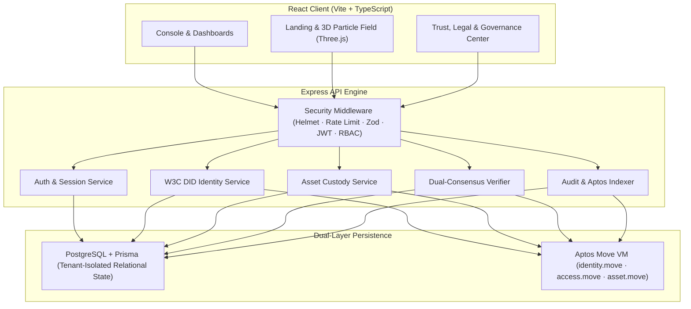
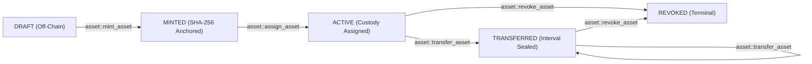

<h1 align="center">Authentra</h1>

<div align="center">
<p bold>Enterprise Identity, Role-Based Access Control & Digital-Asset Custody on Aptos</p>
</div>

Authentra is a zero-trust institutional platform that binds **W3C Decentralized Identifiers (DIDs)**, **server-enforced RBAC**, and **non-destructive digital-asset lifecycles** to the **Aptos Move** blockchain. It pairs relational database throughput with cryptographic, publicly verifiable on-chain provenance.

---

## Core Capabilities

| Domain | Implementation | Guarantees |
|---|---|---|
| **Identity** | `did:authentra:aptos:<address>` | Deterministic W3C DID Core v1.0 resolution backed by Ed25519 keys |
| **Access Control** | 4 Roles · 12 Permissions | Server-enforced RBAC with anti-escalation & tenant isolation |
| **Asset Custody** | Linear State Machine | Non-destructive transitions with non-overlapping `[validFrom, validTo]` intervals |
| **Verification** | Dual-Consensus Engine | Reconciles PostgreSQL state, FIPS 180-4 SHA-256 digests, and Aptos Move resources |
| **Audit Trail** | Append-Only Journal | Captures actor, DID, timestamp, payload, and on-chain Aptos transaction hash |
| **Cryptography** | Argon2id · HMAC-SHA256 | RFC 9106 (64 MB memory cost), constant-time verification, signed JWT sessions |

---

## System Architecture



---

## Asset Lifecycle & Verification Flow

Every asset progresses through a strict, non-destructive linear state machine. History is never overwritten—transfers seal the previous ownership interval and open a new one.



During a public verification check (`GET /api/verification/verify/:id`), the engine:
1. Resolves the asset record and active custodian in **PostgreSQL**.
2. Queries the anchored resource directly from the **Aptos Move** module.
3. Recomputes the deterministic **SHA-256** metadata digest.
4. Walks all ownership intervals in chronological order and emits `VERIFIED`, `MISMATCH`, `UNANCHORED`, or `REVOKED`.

---

## Security Model

- **Password Hashing**: Memory-hard **Argon2id** (RFC 9106: `65,536 KB` memory cost, `3` iterations, `16-byte` random salt) with `crypto.timingSafeEqual` constant-time verification.
- **Session & Transport**: Signed **HMAC-SHA256** JWTs, **Helmet** security headers, **Zod** schema validation on all inputs, and dual-tier rate limiting.
- **Zero-Trust On-Chain Segregation**: Raw PII, emails, and credentials never touch the blockchain. Only pseudonymous DIDs and one-way SHA-256 metadata digests are anchored on Aptos.
- **Anti-Escalation RBAC**: Role privilege boundaries (`ADMIN`, `MANAGER`, `AUDITOR`, `USER`) are enforced server-side on every route; self-escalation is blocked and logged.

---

## Prerequisites

- **Node.js**: v18+ (v20+ recommended)
- **PostgreSQL**: v14+ (local instance or managed, e.g. Neon)
- **Aptos CLI** *(optional)*: Required only for compiling or deploying Move contracts in `contracts/`

---

## Quick Start

### 1. Install Dependencies

```bash
npm install
```

### 2. Configure Environment

```bash
cp .env.example .env
```

Update `.env` with your PostgreSQL `DATABASE_URL`, `JWT_SECRET`, and Aptos Testnet/Mainnet configuration.

### 3. Initialize Database

```bash
npm run prisma:generate
npm run prisma:migrate
npm run prisma:seed
```

### 4. Start Development Servers

```bash
npm run dev
```

| Service | Endpoint |
|---|---|
| **Frontend Client** | `http://localhost:5173` |
| **Backend API** | `http://localhost:5000` |
| **API Health Check** | `http://localhost:5000/api/health` |

---

## Available Scripts

| Command | Description |
|---|---|
| `npm run dev` | Starts server and client concurrently in watch mode |
| `npm run dev:server` | Starts the Express backend (`tsx watch`) |
| `npm run dev:client` | Starts the Vite React frontend |
| `npm run build` | Compiles TypeScript and builds production bundles for all workspaces |
| `npm run build:server` | Builds the server workspace |
| `npm run build:client` | Type-checks and builds the client workspace |
| `npm run lint` | Runs linter checks across server and client |
| `npm run test` | Runs the integration & security test suite |
| `npm run prisma:generate` | Generates the Prisma client |
| `npm run prisma:migrate` | Runs Prisma development migrations |
| `npm run prisma:seed` | Seeds initial workspace data via `prisma/seed.ts` |
| `npm run prisma:reset` | Resets migrations and database state |

---

## Project Structure

```text
authentra/
├── client/                          # React + TypeScript + Vite frontend
│   ├── index.html
│   ├── package.json
│   └── src/
│       ├── App.tsx                  # Hash router, auth gate, theme & layout shell
│       ├── main.tsx
│       ├── index.css
│       ├── components/
│       │   ├── AuthModal.tsx
│       │   ├── InteractiveVerifierPreview.tsx
│       │   ├── landing/             # Hero, Manifesto, Architecture, Lifecycle, Capabilities, Verifier, ClosingCta, Footer, LandingNav
│       │   ├── layout/              # AppShell, UserMenu, nav
│       │   ├── three/               # ParticleField (Three.js WebGL morphing scenes)
│       │   └── ui/                  # Logo, Modal, Panel, PageHeader, Badge, CopyButton, JsonView, ThemeToggle, etc.
│       ├── hooks/                   # useBodyScrollLock, etc.
│       ├── lib/                     # cn, format, smoothScroll
│       ├── pages/                   # LandingPage, DashboardPage, IdentityPage, AssetsPage, VerifyPage, AuditPage, AdminPortalPage, LegalPage
│       ├── services/                # auth.service.ts
│       └── types/                   # auth.types.ts
├── server/                          # Express + TypeScript API engine
│   ├── package.json
│   └── src/
│       ├── app.ts                   # Express app bootstrap & middleware registration
│       ├── config/                  # Environment, database & Aptos configuration
│       ├── controllers/             # auth, identity, asset, verification, audit, blockchain, dashboard, admin
│       ├── middleware/              # auth.middleware, rbac.middleware, error & rate-limit handlers
│       ├── routes/                  # REST route definitions
│       ├── services/                # auth, identity, asset, verification, blockchain, rbac, indexer, dashboard, admin
│       ├── utils/                   # security (Argon2id, JWT, SHA-256), did (W3C DID derivation)
│       └── validators/              # Zod request schemas
├── contracts/                       # Aptos Move smart contracts
│   ├── Move.toml
│   └── sources/                     # identity.move, access.move, asset.move
├── prisma/                          # PostgreSQL schema, migrations, and seed script
│   ├── schema.prisma
│   ├── seed.ts
│   └── migrations/
├── tests/                           # Integration & security test suite
│   ├── integration.test.ts
│   └── comprehensive-audit.ts
├── docs/                            # Platform architecture & protocol documentation
├── package.json                     # Root workspace configuration & scripts
└── README.md
```

---

## Testing

Run the integration and security test suite covering Argon2id hashing, JWT tamper rejection, RBAC enforcement, Aptos Testnet connectivity, dual-consensus verification, and audit trail integrity:

```bash
npm test
```
